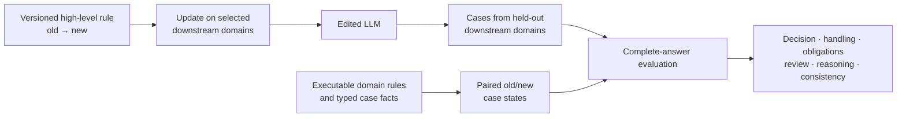

# High-Level Rule Editing with Incomplete Downstream Coverage

**ICDE 2027 supplemental material** · [Download the reproducibility package](./supplement_release.zip)

When a high-level rule changes, downstream case handling may remain stale. This artifact supports a study of whether an LLM taught the revised rule using selected domains can apply it in held-out downstream domains while preserving unaffected requirements.

## At a glance

| Dataset | Count |
|---|---:|
| High-level rule update mechanisms | 9 |
| Semantic case families | 2,420 |
| Training / development / held-out test families | 540 / 180 / 1,700 |
| Meaning-preserving phrasings per family | 3 |

The main comparison evaluates eight systems on the same 1,700 held-out case families. The paper's primary metric is **strict complete-answer correctness**: all eight assessed fields must be correct in one response, without a critical contradiction.

| System | Strict correctness | Final decision | Decision-gated score |
|---|---:|---:|---:|
| GateDistilledGRPO | **52.69%** | 59.45% | 58.10% |
| RTE | 46.27% | 52.92% | 51.80% |
| Case-RAG | 38.86% | 64.39% | 57.35% |
| GPT-6.1-Sol + ICE | 17.61% | **75.71%** | **60.52%** |

All eight systems, five component ablations, and their item-level scores are included in the package. These figures use the frozen v1.1 dataset and v0.6 scorer.

## Package contents

Download [`supplement_release.zip`](./supplement_release.zip), then extract it. The package contains:

| Directory | Contents |
|---|---|
| `data/` | Executable rule specifications, domains, case facts, gold states, prompts, calibration material, and validation report |
| `code/` | Core construction, training, inference, and scoring scripts |
| `predictions/` | Test answers for eight main systems and five ablations |
| `scores/item_scores.csv` | Frozen per-answer judgments for the eight evaluated fields |

Run `python recompute_metrics.py` inside the extracted directory to reproduce the reported strict, decision, decision-gated, and uncertain rates from the frozen judgments. See the package's `README.md` and `manifest.json` for details and checksums.

This repository uses only GitHub-native Markdown and Mermaid rendering; it contains no visitor-tracking images or scripts.
