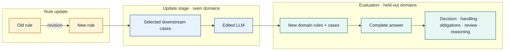

# High-Level Rule Editing in LLMs with Incomplete Downstream Coverage

**ICDE 2027 · Reproducibility artifacts**  
[⬇ Download the complete supplement](./supplement_release.zip) · [Explore the included files](#whats-in-the-package) · [Recompute the metrics](#reproduce-the-results)

> **The question.** After an LLM learns a revised high-level rule from selected domains, can it carry that update into downstream domains absent from training—while keeping unaffected requirements intact?

## The study at a glance

| 9 rule updates | 2,420 case families | 3 phrasings per family | 1,700 held-out test families |
|:---:|:---:|:---:|:---:|
| Distinct update mechanisms | Train 540 · Dev 180 · Test 1,700 | Easy · medium · hard | Domains excluded from training |

Each case family has executable old- and new-rule states. Its three natural-language phrasings express the same facts at different levels of explicitness.

## Main comparison

A response passes **strict complete-answer correctness** only when all eight assessed fields are correct together and there is no critical contradiction. Final decision accuracy and the decision-gated score show complementary aspects of answer quality.

| System | Strict complete answer ↑ | Final decision ↑ | Decision-gated score ↑ |
|:---|---:|---:|---:|
| **GateDistilledGRPO** | **52.69%** | 59.45% | 58.10% |
| RTE | 46.27% | 52.92% | 51.80% |
| Case-RAG | 38.86% | 64.39% | 57.35% |
| GPT-6.1-Sol + ICE | 17.61% | **75.71%** | **60.52%** |

The package includes predictions and item-level judgments for **all eight main systems and five ablations**. The figures above use the frozen v1.1 dataset and v0.6 scorer.

## What's in the package

Download [`supplement_release.zip`](./supplement_release.zip) and extract it.

| Path | What it contains |
|:---|:---|
| `data/` | Rule specifications, downstream domains, typed facts, gold states, prompts, calibration cases, and validation report |
| `code/` | Data construction, training, inference, and scoring scripts |
| `predictions/` | Test responses for the eight main systems and five ablations |
| `scores/item_scores.csv` | Frozen per-response judgments for the eight evaluated fields |
| `manifest.json` | Versions, provenance, and checksums |

## Reproduce the results

Run `python recompute_metrics.py` from the extracted package to recompute strict correctness, final-decision accuracy, decision-gated score, and uncertain rates from the frozen judgments. The package's own `README.md` gives the full instructions.

**Package SHA-256:** `48461dd0dc624a2f4b24f5f6146647e1e91fd4e515d51dc9699c6568f8809fce`

This page uses GitHub-native Markdown and Mermaid; it loads no external images or tracking scripts.

